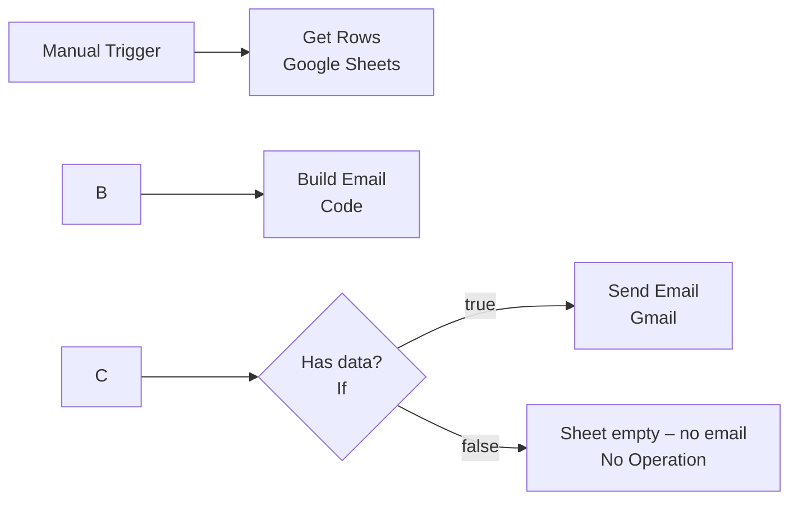

# Google Sheets → Gmail Automation (n8n)

An n8n workflow that reads learner data from a Google Sheet, turns it into a clean, formatted summary email, and sends it through Gmail, end to end, without writing the email by hand.

Built for **Social Eagle – CAIE Course Program, Assignment 9**.

\---

## Workflow



|#|Node|Type|What it does|
|-|-|-|-|
|1|When clicking 'Execute workflow'|Manual Trigger|Starts the workflow|
|2|Get Rows|Google Sheets – Get Row(s)|Reads every row from the `Students` tab. **Always Output Data** is on, so an empty sheet still passes an (empty) item forward.|
|3|Build Email|Code (JavaScript)|Combines all rows into **one** email: subject line, status counts and an HTML table|
|4|Has data?|If|Sends only when the sheet actually has data|
|5|Send Email|Gmail – Send|Sends the HTML email to the chosen address|
|6|Sheet empty – no email|No Operation|Ends the run quietly when the sheet is empty|

\---

## Google Sheet structure

File: `Course Tracker`, tab: `Students`

|Name|Course|Status|
|-|-|-|
|Priya Raman|Gen AI Architect|Completed|
|Arjun Kumar|Python for Data Analysis|In Progress|
|Meena Subramanian|n8n Automation|Completed|
|Karthik Iyer|Prompt Engineering|Not Started|
|Divya Nair|Gen AI Architect|In Progress|

The header names must be exactly `Name`, `Course` and `Status`, because the Code node reads these names.

A second tab, `Empty Test` (headers only), is used to test the empty-sheet case.

\---

## The email

**Subject:** `Course Status Summary – 5 learners – 16 Oct 2026`

**Body (rendered as HTML):**

```
Hi,

Here is the latest data from the Course Tracker sheet (16 Oct 2026).

Total learners: 5
Completed: 2 · In Progress: 2 · Not Started: 1

 # | Name              | Course                   | Status
 1 | Priya Raman       | Gen AI Architect         | Completed
 2 | Arjun Kumar       | Python for Data Analysis | In Progress
 3 | Meena Subramanian | n8n Automation           | Completed
 4 | Karthik Iyer      | Prompt Engineering       | Not Started
 5 | Divya Nair        | Gen AI Architect         | In Progress

Regards,
Your Automation Bot
```

### How the Code node builds it

* Collects all rows in one pass (**Run Once for All Items**), so the result is one summary email rather than one email per row.
* Skips blank rows, and escapes `<`, `>` and `\\\&` so sheet text can't break the HTML.
* Counts learners per status for the summary line.
* Builds a styled HTML table and a subject line with the learner count and today's date (IST).
* Returns `hasData: false` when no rows remain. The If node uses this to stop the send.

\---

## Requirement checklist

|Requirement|How it's met|
|-|-|
|Read data from a Google Sheet|Google Sheets node, *Get Row(s)*|
|Structure into a subject and body|Code node builds `subject` and `body`|
|Send through Gmail to a chosen address|Gmail node, *Send*, Email Type **HTML**|
|Readable, not a raw dump|Summary line, counts, formatted table, greeting and sign-off|
|Handle an empty sheet gracefully|*Always Output Data* + `hasData` flag + If node → no email is sent|
|Credentials kept inside n8n|OAuth2 credentials stored in n8n only; none in this repo|

\---

## Setup

### 1\. Prerequisites

* An n8n instance (this project runs on self-hosted n8n)
* A Google account that owns the sheet and the sending Gmail inbox

### 2\. Google Cloud OAuth (self-hosted n8n only)

n8n Cloud users can simply click **Sign in with Google** and skip this step.

1. In **Google Cloud Console**, create a project.
2. Enable these three APIs: **Google Sheets API**, **Google Drive API** and **Gmail API**.
3. Configure the **OAuth consent screen** (Audience: External) and add your own Gmail as a **Test user**.
4. Create an **OAuth client** (type: Web application). Under **Authorized redirect URIs**, paste the **OAuth Redirect URL** shown in the n8n credential window:
`https://<your-n8n-domain>/rest/oauth2-credential/callback`
5. Copy the **Client ID** and **Client Secret**.

### 3\. n8n credentials

* **Google Sheets OAuth2 API:** paste the Client ID and Secret → **Sign in with Google** → tick all permissions.
* **Gmail OAuth2 API:** use the same Client ID and Secret → **Sign in with Google** → tick all permissions.

### 4\. Import and run

1. In n8n, go to **Workflows → Import from File** and select `workflow.json`.
2. Open **Get Rows** and select your credential, document and sheet.
3. Open **Send Email**, select your Gmail credential, and set **To** to your address.
4. Click **Execute workflow**.

\---

## Testing

|Test|Steps|Expected result|
|-|-|-|
|Data present|Run with the `Students` tab|One formatted email with 5 learners arrives|
|Empty sheet|Switch **Get Rows** to the `Empty Test` tab and run|Flow goes to the **false** branch, and **no email is sent**|
|Data change|Edit a status in the sheet and run again|The email's counts and table reflect the change|

\---

## Issues faced and fixes

|Issue|Cause|Fix|
|-|-|-|
|No *Sign in with Google* button|Managed OAuth is available only on n8n Cloud|Created a Google Cloud OAuth client with a Client ID and Secret|
|`Error 401: invalid\\\_client` (Gmail)|Client ID was pasted incorrectly in the Gmail credential|Re-copied the Client ID (`…apps.googleusercontent.com`) and Secret (`GOCSPX-…`)|
|`Wrong type: ' true' is a string but was expecting a boolean` (If node)|A leading space before `{{ $json.hasData }}` turned the value into text|Removed the space, so the expression is exactly `{{ $json.hasData }}`|

\---

## Repository contents

```
├── workflow.json          # Exported n8n workflow
├── README.md
└── screenshots/
    ├── workflow.png       # Workflow canvas with a successful run
    └── email.png          # Email received in Gmail
```

## Security

* No API keys, client secrets or OAuth tokens are stored in this repository.
* The exported workflow references credentials by name and ID only. The actual secrets stay in n8n's credential store.

\---

**Author:** GANAPATHYRAMAN

&#x20;· Social Eagle CAIE Course Program

